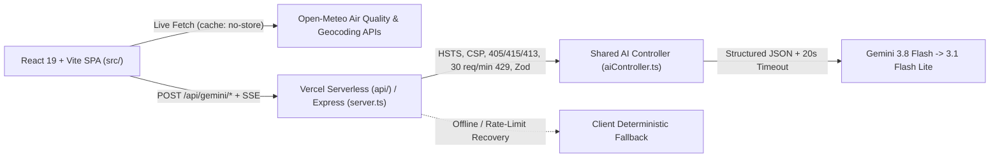

# BreatheWise — Urban Air Quality & Low-Emission Routine Assistant

**Hack2skill PromptWars Challenge 06 ("Build the Urban Air Quality Assistant")**

BreatheWise is an urban air-quality intelligence and low-emission household advisor built for Indian cities. It pairs real-time **Open-Meteo** atmospheric telemetry and deterministic **Indian CPCB National AQI (0–500)** calculations with **Gemini 3.8 Flash** (`@google/genai`) structured synthesis—plus full deterministic fallbacks when offline or rate-limited—so households never receive hallucinated pollutant numbers.

---

## 1. Problem Statement Alignment (Challenge 06)

- **Zero-Hallucination Live Telemetry:** Every AQI reading, sub-index, WHO 2021 guideline ratio, and 24-hour airing window is computed deterministically in TypeScript from live Open-Meteo data before any AI synthesis runs.
- **Actionable Low-Emission Living:** Converts city-level smog data into time-blocked daily routines, room-by-room indoor mitigation plans (HEPA and zero-purifier DIY budget modes), quantified CO₂/PM2.5/₹ habit swaps, emergency smog-shock overrides, and ready-to-share family/RWA/carpool advisories.
- **Honest Provenance:** Every AI response carries explicit provenance (`source: 'gemini-3.8-flash'` / `'gemini-3.1-flash-lite'` vs. `source: 'deterministic'`) alongside the live Open-Meteo source URL and local reading timestamp.

---

## 2. System Architecture & Serverless Security Model



- **Shared Controller (`src/services/aiController.ts`):** Both `server.ts` (Express + Vite SSR/static host) and `api/**/*.ts` (Vercel Node 22 ESM Serverless Functions) run the exact same HTTP method/content-type/128 KB guards, per-IP sliding-window rate limiter (`30` req/min -> HTTP `429` + `Retry-After`), and Zod trust boundaries (`src/validation/aqiContracts.ts`).
- **Transport Hardening (`vercel.json` & `server.ts`):** Sends `Strict-Transport-Security`, restrictive `Content-Security-Policy`, `X-Content-Type-Options: nosniff`, `X-Frame-Options: DENY`, `Referrer-Policy`, and `Permissions-Policy`.
- **API Endpoints:**
  - `GET /api/health`
  - `POST /api/gemini/questions` & `POST /api/gemini/questions/stream` (SSE incremental streaming)
  - `POST /api/gemini/routine`
  - `POST /api/gemini/indoor`
  - `POST /api/gemini/shock`
  - `POST /api/gemini/community`

---

## 3. Five Workspaces & 1-Click Evaluator Profiles

1. **Intake (`ProfileIntakeWorkspace`):** All-India city search + quick city chips (`Delhi`, `Noida`, `Chandigarh`, `Mumbai`, `Kolkata`, `Bengaluru`), CPCB AQI meter, WHO 2021 pollutant ratios, 4 one-click sample profiles, custom household builder, and streaming clarifying intake.
2. **Routine (`DailyRoutineWorkspace`):** 24-hour Recharts PM2.5 trajectory chart with shaded safest 3-hour cross-ventilation band, peak smog danger hours, and interactive 4-block checklist (`Morning`, `Midday`, `Evening`, `Night`) updating the live **Protection Score (%)**.
3. **Indoor Lab (`IndoorLabWorkspace`):** Synced HEPA vs. zero-purifier DIY controls, cooking fuel & exhaust toggles, active room slider, deterministic indoor PM2.5 reduction meter, targeted indoor questions, and room-by-room playbooks (`Living Room`, `Bedroom / Nursery`, `Kitchen`) with a scientific note on indoor plants.
4. **Simulator (`AlternativesSimulatorWorkspace`):** Low-emission habit swap engine calculating weekly/annual CO₂ avoided, diminishing-returns PM2.5 exposure reduction, and monthly ₹ savings, plus the **"What-If" Sudden Smog Spike Simulator** that patches active routine blocks in one click.
5. **Community (`CommunityBriefingWorkspace`):** Copyable WhatsApp family advisory, RWA/apartment notice, and carpool pitch, plus one-click **JSON** and **Printable Markdown** Master Clean-Air Runbook exports (`RunbookExportSection`).

---

## 4. Code Quality & Testing

- **Strict Static Analysis:** ESLint 9 flat config (`npx eslint . --max-warnings=0`, `@typescript-eslint/no-explicit-any: error`, `@typescript-eslint/explicit-module-boundary-types: error`), Prettier formatting enforcement, TypeScript strict mode (`noUnusedLocals`, `noUnusedParameters`), `readonly` React prop contracts, and every file kept strictly under **250 lines**.
- **Accessibility & Resilience:** React `<ErrorBoundary>` + `<Suspense>` isolation, semantic HTML5 landmarks (`<header>`, `<nav>`, `<main id="main-content">`), skip link, WAI-ARIA roving keyboard tabs (`ArrowRight`/`ArrowLeft`/`Home`/`End`), native `<dialog>` with Escape close & focus restoration, and WCAG AA contrast.
- **Automated Test Suite (60+ Tests):** Covers CPCB piecewise AQI interpolation, Open-Meteo telemetry, emissions math, SSE stream parsing, API security guards (`405`/`415`/`413`/`429`), secret-free error redaction, and accessible UI components under enforced V8 coverage thresholds (`95%` statements/lines/functions, `80%` branches).

### Local Setup (Node 22.x) & Verification

```bash
npm ci
cp .env.example .env
# Set GEMINI_API_KEY in .env (optional: GEMINI_MODEL=gemini-3.8-flash)
npm run dev
```

```bash
npm run check           # ESLint (--max-warnings=0 via eslint), tsc --noEmit, Prettier check, Vitest, Vite build
npm run test:coverage   # Enforces 95% statements/lines/functions and 80% branches
```

### Vercel Deployment

- `vercel.json` configures `maxDuration: 30` for `api/**/*.ts`, production security headers, `/api/*` routing, and `/index.html` SPA fallback.
- Configure `GEMINI_API_KEY` (and optionally `GEMINI_MODEL=gemini-3.8-flash`) in Vercel Project Environment Variables and deploy with `vercel --prod`.
